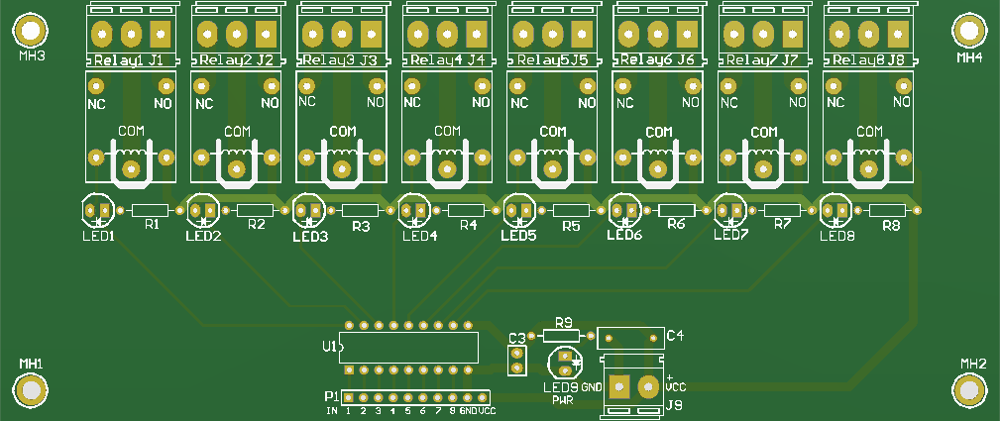
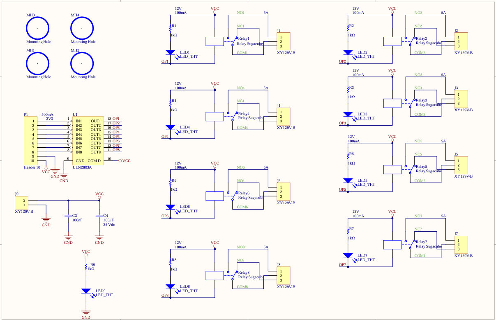
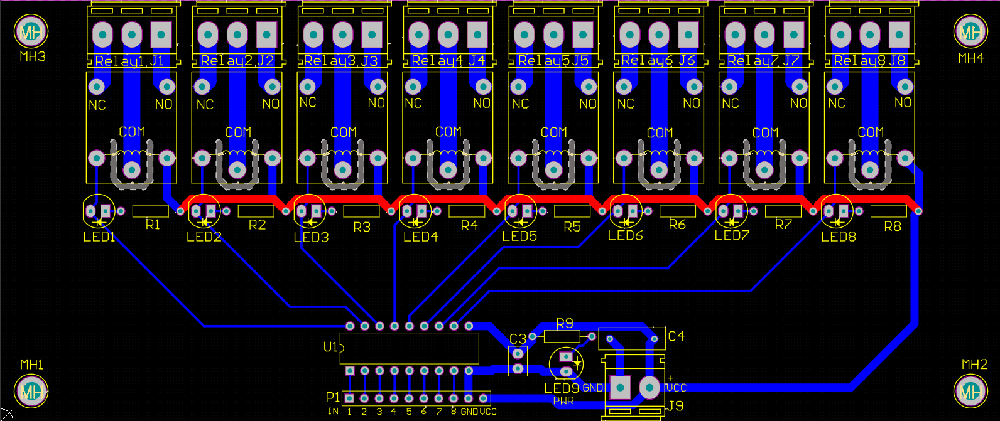
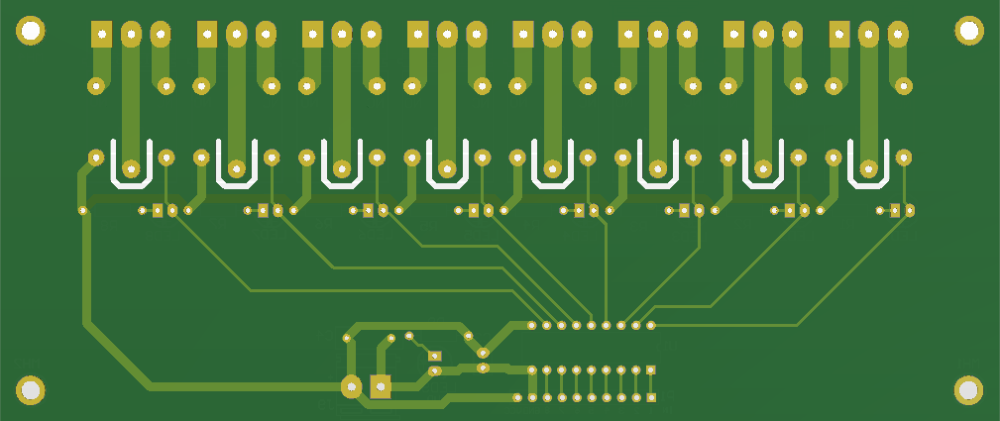

# 8-Channel Relay Card
An 8-channel relay board that lets a microcontroller switch mains-powered devices on and off, up to 5 A each. Each channel has a status LED and a screw terminal for connecting the load. Designed in Altium.

**Status:** PCB layout complete, DRC passed with no electrical errors. 3D component models and Gerber files in progress.



---

## Features

- 8 independent relay channels, controlled from 3.3 V logic
- ULN2803 Darlington driver with built-in flyback diodes
- Contacts rated for mains switching, up to 5 A per channel
- NO / COM / NC screw terminals on every channel
- Status LED per channel, plus a power LED
- Slots around each relay's COM pin for extra creepage between mains and low voltage
- 4 × M3 mounting holes

## Specifications

| Parameter | Value |
|---|---|
| Supply voltage | 12 V DC (J9) |
| Coil current | about 100 mA per channel, 800 mA with all 8 on |
| Control inputs | 3.3 V logic (P1) |
| Contact current | up to 5 A per channel |
| Board size | 71.9 mm wide × about 171 mm long, 2 layers |
| Design tool | Altium Designer |

---

## How it works

Each channel works the same way. Using channel 1 as the example:

1. The microcontroller sets **IN1** high (3.3 V).
2. The ULN2803 switches on and connects output **OP1** to GND.
3. Current flows **12 V → relay coil → OP1 → ULN2803 → GND**. The coil becomes a magnet and pulls the relay's contact from **NC** to **NO**.
4. **LED1** (through R1) lights up at the same time.
5. When IN1 goes low, the coil switches off and a spring returns the contact to NC.

The ULN2803's **COM pin (pin 10) is tied to 12 V**. This connects the chip's internal flyback diodes across the coils, which absorb the voltage spike each coil produces when it switches off.

### Wiring a load

Switch the **phase (live)** through the relay, and run the **neutral** straight to the load:

```
AC Phase (L) ── COM ──[relay]── NO ── Load ── AC Neutral (N)
```

Switching the phase means the load is completely disconnected from mains when the relay is off. Switching the neutral instead would leave the load live even when it looks off.

---


## Design decisions

### Trace widths

First I worked out the current in each trace:

| Trace | Current |
|---|---|
| One relay channel (coil + LED) | 0.1 A |
| Main VCC and GND lines | 0.8 A (8 channels × 0.1 A) |
| Relay contacts → terminals | 5 A |
| Input signals | a few mA |

Then I checked widths in **Saturn PCB Toolkit** (Conductor Properties, IPC-2152): 35 µm copper + 35 µm plating (70 µm total), external layer, 10 °C temperature rise, DC.

| Load current | Width tested | Saturn: maximum current | Width used |
|---|---|---|---|
| 5 A | 3 mm | 5.32 A | **3 mm** |
| 0.8 A | 0.5 mm | 1.82 A | **1.5 mm** |
| 0.1 A | 0.1 mm | 0.58 A | **0.5 mm** |

- **Only the 5 A traces are limited by current.** 3 mm is the narrowest width Saturn confirmed for 5 A.
- **VCC and GND** would work at 0.5 mm, but 1.5 mm gives safety margin on the lines that carry all 8 channels' current.
- **Signal traces** only need 0.1 mm for their current, but that's too thin to manufacture reliably, so they use 0.5 mm (down to 0.254 mm between IC pins).

These are set as Altium design rules with net classes, so the router uses the right width automatically and DRC flags any mistake:

| Priority | Rule | Applies to | Min / Preferred / Max |
|---|---|---|---|
| 1 | Width_relay | Relay contact nets | 3 / 3 / 5 mm |
| 2 | Width_Power | VCC, GND | 1.0 / 1.5 / 3 mm |
| 3 | Width (default) | Everything else | 0.254 / 0.5 / 3 mm |

The more specific rules sit above the general one, so they take priority.

### Mains safety

- **Separation:** all mains parts (relay contacts, terminals and their traces) are on the top half of the board; the 12 V and 3.3 V circuits are on the bottom half.
- **Slots:** on these relays, the COM pin (mains) sits between the two coil pins (12 V). A U-shaped board cutout around each COM pin makes the creepage path, the distance along the board surface, longer. Each slot is at least 1 mm wide and at least 0.5 mm from any pad, checked with a Board Outline Clearance DRC rule.
- **Mounting holes** near the terminals are about 8–10 mm from the nearest mains copper.

### Component values

- **LED resistors (R1–R9): 1 kΩ, ¼ W.** (12 V − 2 V LED) ÷ 10 mA = 1 kΩ, dissipating 0.1 W. The channel LEDs get about 9 mA, because the ULN2803 drops about 1 V when on.
- **C4: 100 µF, 25 V electrolytic.** A bulk capacitor that supplies the current surge when several relays switch on together.
- **C3: 100 nF, 50 V ceramic.** Handles fast, high-frequency noise, such as the spikes when the coils switch off.
- Both capacitors sit right next to the power input J9.

### Layout

- The board's width of **71.9 mm** was chosen to fit a 71.9 mm PCB profile (enclosure). The length of the profile can vary, so the board's length was set by what the 8 channels need.
- All 8 channels in one row, in order, with the terminal blocks on the board edge so wires can be connected.
- The ULN2803's outputs face the relays and its inputs face P1, so the traces fan out without crossing.
- VCC runs on the top layer beneath the LED row, away from the relays' COM pins; signals run on the bottom layer.

---

## Images

### Schematic


### PCB layout


### 3D view, bottom


---

## Safety

This board switches **mains voltage**, which can kill. Only wire mains loads if you are qualified to, with the power disconnected, and inside a closed enclosure. Nylon screws and standoffs are recommended for mounting.


## Tools

- Altium Designer: schematic, PCB layout, DRC, 3D view
- Saturn PCB Toolkit: trace width calculation (IPC-2152)
